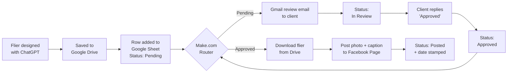

# facebook-flier-bot-make_vtb
Monthly Facebook flier automation for a hair stylist: Google Sheets approval queue + Make.com + Facebook Pages, with a client review step.

# 💇‍♀️ Facebook Flier Bot for a Hair Stylist

A no-code automation that posts a monthly promotional flier to a hair stylist's Facebook Page, **only after the client approves it**.

Built with **Make.com**, **Google Sheets**, **Google Drive**, **Gmail**, and the **Facebook Pages** API, on free plans.

> **Client:** Rylee Bennett, hair stylist — [R.cobeauty](https://www.facebook.com/) (South Elgin, IL)
> **Built by:** Tabitha Bebee
> **Status:** ✅ Live — first flier posted November 5, 2026
> Shared with the client's written permission.

---

## The problem

Rylee is a busy stylist who specializes in custom color, blonding, and vivids. She wanted consistent monthly promotions on Facebook (holiday booking reminders, seasonal color specials) without having to remember, design, and post them herself every month.

**Requirements**
- One eye-catching flier per month, posted to her Facebook Page
- She must **approve every flier** before it goes public
- Keep it **as close to free as possible**
- No sharing of her passwords

---

## How it works

### Status flow
| Status | What it means | Who sets it |
|---|---|---|
| **Pending** | Flier is ready to be reviewed | Me |
| **In Review** | Review email sent to the client | The bot |
| **Approved** | Client said yes | Me, after the client replies |
| **Posted** | Live on Facebook, date stamped | The bot |

### The Make.com scenario
1. **Google Sheets: Search Rows**, which finds rows where Status is `Pending` OR `Approved`
2. **Router**, which splits into two filtered paths:
   - **Pending → Email for review:** Gmail sends the flier link, caption, and post date → Sheets updates Status to `In Review`
   - **Approved → Post it:** Google Drive downloads the flier → Facebook Pages *Upload a Photo* posts it with the caption → Sheets updates Status to `Posted` and stamps the date

---

## Tools and cost

| Tool | Purpose | Monthly cost |
|---|---|---|
| Make.com (free plan) | Automation | $0 (~10 credits/month of 1,000) |
| Google Sheets + Drive | Approval queue + flier storage | $0 |
| Gmail | Review emails | $0 |
| Facebook Pages | Publishing | $0 |
| ChatGPT | Flier design | Existing subscription |
| **Total** | | **$0/month** |

---

## Build stats

- **Total build time:** ~8 hours (tracked task-by-task in a live tracker)
- **From first idea to first live post:** 14 days, around school and other projects
- **Experiments that didn't make the cut:** Instagram posting, AI auto-generated fliers (~$0.20 in API tests)

---

## Challenges and what I learned

**1. Getting access to the client's Facebook Page**
The plan was for the client to add me as a Page admin. Her Page lives in a Meta business portfolio, the invite failed repeatedly, and the brand-new Facebook account I created for it was flagged and banned.
**Fix:** the client logs in herself during the Make connection over a Zoom call with remote control. Her password never touches my hands.
**Lesson:** default to the client connecting their own accounts. Never create a brand-new, empty Facebook account just for client work.

**2. Instagram was dropped**
Instagram posting requires a Business/Creator account linked to the Facebook Page, which wasn't viable for this client.
**Lesson:** confirm every platform's account requirements before promising it.

**3. AI auto-generated fliers didn't match the approved look**
I built a path that generated fliers with the OpenAI image API. Two rounds of tests (cartoon, then semi-realistic) didn't match the style the client loved.
**Fix:** kept ChatGPT as a hands-on design step and removed the auto-generate path.
**Lesson:** lock in the look before automating it. Prompt-only image generation can't reliably match a specific approved style or face.

**4. Small technical gotchas**
- Pulling a Google Drive file ID out of a share link with `split()` (the empty piece after `https://` is skipped, so the ID is piece 5)
- *Web View Link* vs *Web Content Link*. Only one works with the download step
- A 15-minute default schedule would have burned ~2,900 credits/month. It's now run on demand

---

## What's next
- [ ] Date-based timing: review email ~1 week before each post date, auto-post on the date, daily check
- [ ] Error alert email if a post fails
- [ ] Track results (reach, reactions, bookings) from Facebook Insights
- [ ] Move the scenario to the client's own Make account when she's ready

---

## Repo contents
| Folder / File | What's inside |
|---|---|
| `BUILD_LOG.md` | Dated build log with time spent |
| `docs/` | Client guide and Google Sheet layout |
| `screenshots/` | Make scenario, review email, live post |
| `make-blueprint/` | Exported Make scenario (sanitized) |
